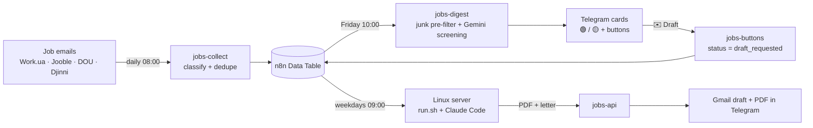

# Job Search Automation

An end-to-end pipeline that reads job emails, filters them with AI, sends me a weekly digest in Telegram, and — on one button tap — writes a tailored resume and cover letter and drops them into Gmail as a draft. I only review and hit **Send**.

## Why
Job boards send dozens of emails a week, most of them irrelevant. Reading them, deciding, and then tailoring a resume for every application takes hours. This pipeline cuts my part down to two taps.

## How it works

1. **Collect** (`jobs-collect`, 6 nodes) — every morning reads the job mailbox, classifies emails (direct recruiter message / vacancy / newsletter), skips service mail, dedupes and stores them in an n8n Data Table.
2. **Screen** (`jobs-digest`, 14 nodes) — every Friday a code pre-filter drops obvious junk (confirmation codes, count-only newsletters) to save AI quota, then Gemini rates each vacancy against my profile: 🟢 fits, 🟡 partly fits, 🔴 skip. Fits become Telegram cards: what they want, what they offer, why it fits, an application tip, link.
3. **Decide** (`jobs-buttons`, 5 nodes) — each card has **✉️ Make a draft** / **❌ Skip**. The tap updates the row status and edits the card.
4. **Generate** (`server/run.sh`) — on weekdays at 09:00 my Linux server pulls the queue from `jobs-api`, asks Claude Code to tailor resume content and a cover letter strictly from a facts file, renders the HTML template to a one-page PDF with headless Chromium (with an overflow check), and posts the result back.
5. **Deliver** (`jobs-api`, 11 nodes) — n8n creates a Gmail draft with the PDF attached and sends the PDF + letter to Telegram. For Djinni chats (no email) it sends a chat link instead.

## Notable details
- **Facts-only generation:** the model may rephrase and reorder, but never invent experience, numbers or tools.
- **Cover letter language = vacancy language**; recruiter-first messages get context-aware openers; Djinni replies are short chat messages.
- **Rate-limit aware:** junk is filtered in code before the free-tier LLM sees it.
- **No inbound ports on the server:** it only makes outbound calls to n8n webhooks, authenticated with a shared header key.
- **Dry-run mode** (`./run.sh --dry-run`) for safe testing.

## Stack
n8n (Gmail, Data Tables, AI Agent, Telegram, Webhooks) · Google Gemini · Claude Code (`claude -p`) · Bash · headless Chromium · Hetzner Linux server · cron

## Setup
1. Import `workflows/*.json` into n8n, connect your own Gmail / Telegram / Gemini credentials.
2. Create a Data Table with the columns used in the workflows and put its id instead of `YOUR_DATA_TABLE_ID`.
3. Replace `YOUR_JOBS_KEY`, `YOUR_TELEGRAM_CHAT_ID`, `your-instance.app.n8n.cloud`.
4. On a server with Claude Code: copy `server/`, add your own facts file and photo, create `.env`, run `./run.sh --dry-run`, then add the cron line.

---
Built by Anastasiia Ukrainska · [Portfolio](https://app.notion.com/p/Anastasiia-Ukrainska-AI-Automator-3c61a7c286c881c7b3f0e59620343c67)
